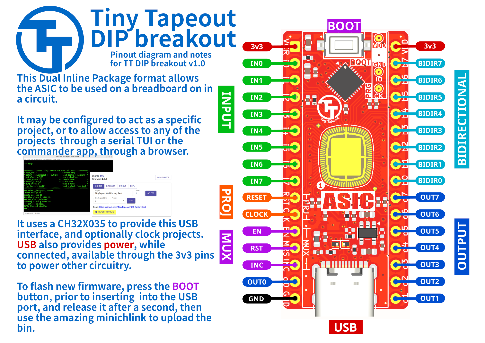

# TT GF180 CoB DIP Breakout

This breakout, with its small 32 pin form factor, allows you to drop an ASIC into your circuits.

It exposes

  * all the I/O (8 in, 8 out and 8 bidirectional);
  * the project clock and reset; and
  * the Tiny Tapeout project MUX, to select the design
  
The ASIC may be used "raw" -- meaning all control is left to external circuitry, such that designs are selected and clocked from the outside -- or leverage the on-board [CH32X035 MCU](https://www.wch-ic.com/downloads/CH32X035DS0_PDF.html) to select designs, clock projects and more.

[Firmware is available](https://github.com/psychogenic/TT-DIP) to auto-select designs on powerup, do auto-detection of external drivers (for either project clock/reset or design selection MUX, or both) and even provide a serial TUI.  See the [firmware docs](https://github.com/psychogenic/TT-DIP) for details.

## Updates

Updating the firmware involves holding the BOOT button during power-up, and uploading the firmware via USB. 

## Schematic

