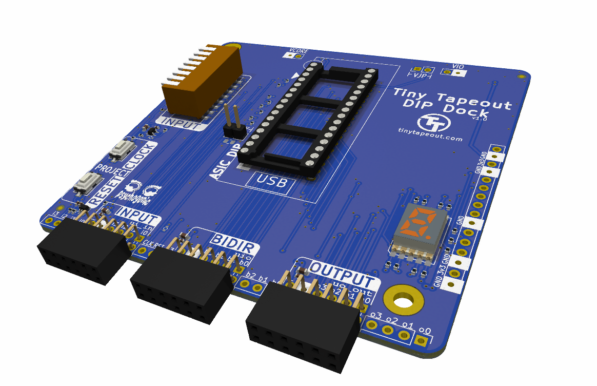
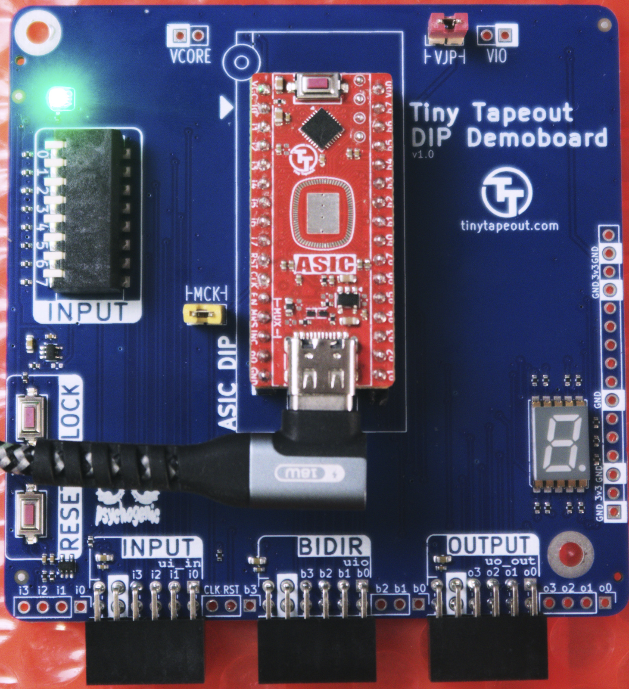
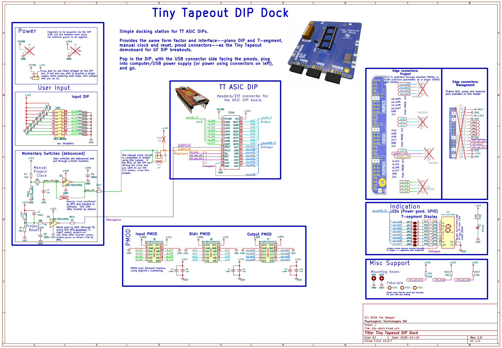

# TinyTapeout DIP Dock

Docking station for Tiny Tapeout DIP breakouts

This simple board provides the same footprint, and same interfaces:

 * piano input DIP
 * 7-segment display
 * pmods for I/O
 * manual clock and reset
 
as the [Tiny Tapeout Demoboard](https://github.com/TinyTapeout/tt-demo-pcb) for ASICs delivered using the [DIP breakout](https://github.com/TinyTapeout/breakout-pcb/tree/main/breakout-dip-gf).

Just pop it in (you may use pin headers but there's space for a ZIF socket) and can connect extension boards through the pmod headers, or interact with it as on a regular demoboard.

It can be powered and interacted with via USB (through the [TT DIP firmware](https://github.com/psychogenic/TT-DIP)'s USB serial interface and (maybe?) [commander](https://commander.tinytapeout.com/), or power may be provided externally through the VIO/VCORE headers.

## Schematic and Function

The board is very simple, and designed using only two layers

Two jumpers are used:
  * one, marked VJP, bridges the VIO and VCORE (this is likely already happening internally on the DIP); 
  * the other, marked MCK, connects the manual clock button output to the project clock (which is otherwise only connected to the DIP MCU and interface pad on the bottom of the board, between the pmods)
  

## License

The PCB is licensed under the [Apache2 License](LICENSE)
